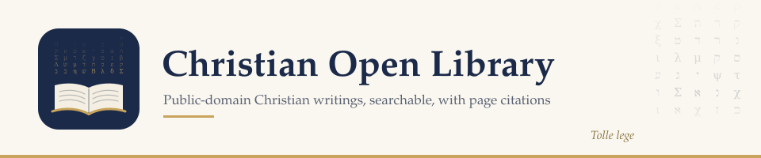

<picture>
  <source media="(prefers-color-scheme: dark)" srcset="https://raw.githubusercontent.com/Christian-open-library/.github/main/profile/banner-dark.svg">
  
</picture>

A curated library of public-domain books in plain, searchable text, centered on the Christian tradition:

- **Theology and devotion:** the Church Fathers, the Reformers, the Puritans, Edwards, and historic creeds and confessions.
- **Commentaries and original-language help:** verse by verse, including Calvin, Matthew Henry, Gill, Poole, and Keil and Delitzsch on the Old Testament, plus Greek and Hebrew lexicons and grammars, the Expositor's Greek Testament, Trench's *Synonyms*, and the Treasury of Scripture Knowledge.
- **Sermons:** Spurgeon, Whitefield, M'Cheyne, Chalmers, and Simeon's 2,500 sermon outlines on the whole Bible.
- **Journals:** the Princeton Review and its successors (1831–1929), with articles by Charles Hodge, the Alexanders, Warfield and Machen, and the Danville Quarterly Review.
- **Poetry and fiction:** Herbert, Milton, Donne, Rossetti, George MacDonald, Chesterton, Dostoevsky, and more.
- **Philosophy:** Plato, Aristotle, the Stoics, Descartes, Spinoza, Locke, Hume, Kant, Hegel, Nietzsche, Mill, William James, and more, in older translations.
- **Classics and other traditions, for context:** Homer, Virgil, Thucydides, the Greek tragedians, Confucius, Lao Tzu, the Bhagavad-Gita, the Koran, and Maimonides.
- **Reference:** seven Bibles, classic Bible dictionaries, and The Fundamentals.

It is curated by [Matt Miller](https://github.com/mattm4444).

## What's here

| Collection | What it holds | Access |
|---|---|---|
| **The Library** | About 4,400 public-domain and Creative Commons works, from antiquity to the 1920s, in their original editions where possible: theology, commentaries, sermons, journals, philosophy, poetry and fiction | Free, by invitation |
| **AI connector** | Search the whole library from Claude, ChatGPT, Gemini and other AI apps that support connectors, by meaning, with word-for-word quotations, citations, seven Bibles (Berean Standard Bible by default), dictionaries, and a finder for which historic writers cited any verse | Free for anyone: sign in with your email or GitHub |

**Browse every title:** [`catalog.csv`](https://github.com/Christian-open-library/.github/blob/main/catalog.csv) (author, title, year, type).

## Use the AI connector

Free for anyone; no invitation needed. Add this address to your AI app, then sign in with your email (you'll get a code) or with GitHub when it asks:

```
https://mcp.christianopenlibrary.org/mcp
```

- **Claude:** Settings → Connectors → **Add custom connector**, paste the address, then **Connect**.
- **ChatGPT** (paid plans): Settings → Apps & Connectors → turn on Developer mode → **Create**, paste the address, choose OAuth.
- **Gemini:** Settings → Connected Apps → **Add a custom app**, paste the address.

Menu names change from time to time; look for "connectors" or "MCP" in your app's settings. Each person has a fair-use daily limit.

The connector's code is open: **[read the source](https://github.com/Christian-open-library/Connector)** and the **[security review](https://github.com/Christian-open-library/Connector/blob/main/docs/security-review.md)**. It keeps no copy of your conversations or documents, it does not log what you search for, and it only reads public-domain and openly licensed books. Sign-in and search each involve an outside service: **[what happens to your question](https://github.com/Christian-open-library/.github/blob/main/PRIVACY.md)** lists everyone who sees it.

## Download the books

The books themselves are shared by invitation. **[Request access](https://github.com/Christian-open-library/.github/issues/new?template=request-library-access.yml)**, accept the invitation email from GitHub, then open the library and choose **Code → Download ZIP**, or clone it with git.

## Help the library grow

- **[Suggest a book](https://github.com/Christian-open-library/.github/issues/new?template=suggest-a-book.yml)** you've found in a public-domain source.
- **[Connector feedback](https://github.com/Christian-open-library/.github/issues/new?template=connector-feedback.yml):** tell me when the AI connector missed a book or quoted out of context. Each report becomes a test the connector has to pass. The form is public and needs a GitHub account; you can also write to **hello@christianopenlibrary.org**.
- **[Corrections log](https://github.com/Christian-open-library/.github/blob/main/CORRECTIONS.md):** every error found and fixed, in the books, the connector or this page.
- Members can add books directly by pull request, following the library's contributing guide.

Only free-to-share texts are accepted:

- public domain (generally published in the US before 1931);
- Creative Commons licensed.

I review every addition for copyright and duplicates before it goes in. If something slips through, the copyright concern form below gets it removed.

## How to check it

Don't take the library on trust. This is how to check it.

- **Quotations are word for word from the library's copy.** The connector returns each passage exactly as it stands in the library's copy, with the author and title, and the year and page where the source gives them. The copies are not perfect: scanned books have misread letters, and some texts have no year or page numbers.
- **Every quotation can be traced.** Each result carries a reference (such as P1234500017) and a link to where the library's copy came from. Results from Internet Archive scans link to the page itself. If an answer quotes an author without a reference and a link, ask the AI where the words came from.
- **The AI app writes the answer.** The connector finds and quotes. Your AI app (Claude, ChatGPT or Gemini) reads the passages and writes the answer, and it can summarize badly or quote from memory. Check a quotation against its source before you print or preach it.
- **It says when it has nothing.** When the library doesn't have a book, or has nothing close to what was asked, the connector says so and tells the AI not to fill the gap from memory. Each result is marked as an exact, close, partial or loose match.
- **Scans are marked.** Every passage from a scanned book is marked as uncorrected OCR.
- **Every book names its source.** Each file records where its text came from and its license. Only public-domain and openly licensed works are included.
- **The library doesn't modernize.** It doesn't modernize, correct or abridge the texts it copies. Some sources had already edited their editions; each file names its source, so you can see which edition you are reading.
- **It is measured.** [How well it finds things](https://github.com/Christian-open-library/.github/blob/main/ACCURACY.md) is tested on a fixed set of questions, and the results are published, misses included.
- **Corrections are public.** Errors that are found and fixed are listed in the [corrections log](https://github.com/Christian-open-library/.github/blob/main/CORRECTIONS.md).
- **You can see where your question goes.** The connector keeps no copy of your conversations or documents and doesn't log what you search for. [What happens to your question](https://github.com/Christian-open-library/.github/blob/main/PRIVACY.md) names every party that sees it.
- **Open code, reviewed with AI.** The [code is public](https://github.com/Christian-open-library/Connector), and so is its [security review](https://github.com/Christian-open-library/Connector/blob/main/docs/security-review.md). The review was carried out with Claude, Anthropic's AI. No outside firm has audited it.
- **One person, no ads.** A personal project curated by Matt Miller. It has no ads, and no church or denomination directs or endorses it.

## Support the library

The library and the AI connector are free for everyone. If they're useful to you, you can support Matt Miller's work on them. The card shows what the connector costs to run each month, and it updates as more people use it.

<a href="https://github.com/sponsors/mattm4444">
  <picture>
    <source media="(prefers-color-scheme: dark)" srcset="https://mcp.christianopenlibrary.org/support.svg?theme=dark">
    
  </picture>
</a>

**[Give through GitHub Sponsors](https://github.com/sponsors/mattm4444)**, monthly or once. Gifts go to Matt personally to support his work on the library, and aren't tax-deductible.

## Credits

- **Christian Classics Ethereal Library.** Many of the texts come from [CCEL](https://ccel.org) at Calvin University, which prepared the electronic editions and asks that its files not be sold. The library is free and sells nothing.
- **Other sources.** The Text Creation Partnership (EEBO-TCP, Evans-TCP and ECCO-TCP), the Internet Archive, Project Gutenberg and Standard Ebooks. Every book's file names the page it came from.
- **Greek and Latin texts.** The Greek and Latin texts of the Church Fathers and Philo, and Yonge's English translation of Philo, come from the [Open Greek and Latin Project](https://github.com/OpenGreekAndLatin) at the University of Leipzig ([First1KGreek](https://github.com/OpenGreekAndLatin/First1KGreek) and [csel-dev](https://github.com/OpenGreekAndLatin/csel-dev)), licensed [CC BY-SA 4.0](https://creativecommons.org/licenses/by-sa/4.0/). They were converted from the project's TEI XML to Markdown, and the library's copies are shared under the same license.

## Copyright and security

- **Copyright concern?** If you believe something in the library shouldn't be here, use the **[copyright concern form](https://github.com/Christian-open-library/.github/issues/new?template=copyright-concern.yml)**. I review it and remove the material promptly. You can also write to hello@christianopenlibrary.org.
- **Security:** the connector is read-only and was put through a structured security review, carried out with Claude, Anthropic's AI (not an outside audit). Read the [summary](https://github.com/Christian-open-library/.github/blob/main/SECURITY.md). To report a problem privately, use **Report a vulnerability** on that page's repository.

<p align="right"><sub><samp>// soli deo gloria</samp></sub></p>
