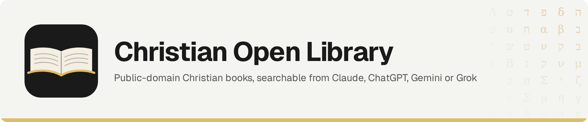

<picture>
  <source media="(prefers-color-scheme: dark)" srcset="https://raw.githubusercontent.com/Christian-open-library/.github/main/profile/banner-dark.png">
  
</picture>

Christian books and historic records from the Church Fathers to the early 1900s. Free to search. An independent library of about 7,700 public-domain works and the records of more than 80 denominations, all in plain text. It holds:

- **Theology and devotion:** the Church Fathers, the Reformers, the Puritans, Edwards, and historic creeds and confessions.
- **Denominational records:** constitutions, books of order and discipline, digests, and General Assembly, convention and conference minutes up to 1930. They come from more than 80 Presbyterian, Baptist, Methodist, Holiness, Anglican, Lutheran, Catholic, Orthodox, Quaker and other church bodies. Ask polity, history and theology questions about your own denomination. Tell your AI app your church ("I'm in the PCA", "UMC", "LCMS"). It will search only the records of that body and the bodies it came from. Each result is labeled with its edition and year. These are historical editions, so a church's current rules may differ.
- **Commentaries and original-language help:** verse-by-verse commentaries by Calvin, Matthew Henry, Gill, Poole, and Keil and Delitzsch on the Old Testament. Also Greek and Hebrew lexicons and grammars, the Expositor's Greek Testament, Trench's *Synonyms* and the Treasury of Scripture Knowledge.
- **Sermons:** Spurgeon, Whitefield, M'Cheyne, Chalmers, and Simeon's 2,500 sermon outlines on the whole Bible.
- **Journals:** the Princeton Review and its successors (1831–1929), with articles by Charles Hodge, the Alexanders, Warfield and Machen. Also the Danville Quarterly Review.
- **Poetry and fiction:** Herbert, Milton, Donne, Rossetti, George MacDonald, Chesterton, Dostoevsky, and more.
- **Philosophy:** Plato, Aristotle, the Stoics, Descartes, Spinoza, Locke, Hume, Kant, Hegel, Nietzsche, Mill, William James, and more, in older translations.
- **Classics and other traditions, for context:** Homer, Virgil, Thucydides, the Greek tragedians, Confucius, Lao Tzu, the Bhagavad-Gita, the Koran, and Maimonides.
- **Reference:** Bible translations, classic Bible dictionaries, and The Fundamentals.

**No AI-written or AI-translated text.** Every book is the published work of a human author or translator, copied from the printed edition or a transcription of it.

The Christian Open Library is an independent library of Christian books and church records. [Matt Miller](https://github.com/mattm4444), a pastor in the Presbyterian Church in America, founded it. It is not a ministry of any church, presbytery or denomination. None of them directs or endorses it. Write to us at **hello@christianopenlibrary.org**.

**Website: [christianopenlibrary.org](https://christianopenlibrary.org)**. It has step-by-step setup for each AI app, how to check an answer and how to download the books.

**On X: [@openlibraryall](https://x.com/openlibraryall)** for news of new books. Ask questions there too.


## What's here

| Collection | What it holds | Access |
|---|---|---|
| **The Library** | About 7,700 public-domain and Creative Commons works from antiquity to the early 1900s, in their original editions where possible. Theology, commentaries, sermons, journals, the records of more than 80 denominations, philosophy, poetry and fiction | Free, by invitation |
| **AI connector** | Search the whole library by meaning from Claude, ChatGPT, Gemini, Grok and other AI apps with connectors. Word-for-word quotations with citations. Bible translations, dictionaries and a finder for which historic writers cited any verse | Free for anyone: sign in with your email or GitHub |

**Browse every title:** [`catalog.csv`](https://github.com/Christian-open-library/.github/blob/main/catalog.csv) (author, title, year, type).

## Use the AI connector

Free for anyone. No invitation needed. Add this address to your AI app. When it asks, sign in with Google, your email (you'll get a code) or GitHub:

```
https://mcp.christianopenlibrary.org/mcp
```

- **Claude:** Settings → Connectors → **Add custom connector**, paste the address, then **Connect**.
- **ChatGPT** (paid plans): Settings → Apps & Connectors → turn on Developer mode → **Create**, paste the address, choose OAuth.
- **Gemini:** Settings → Connected Apps → **Add a custom app**, paste the address.
- **Grok:** grok.com/connectors → **New Connector** → **Custom**, paste the address.

Menu names change from time to time. If one is missing, look in your app's settings for "connectors" or "MCP". Each person has a fair-use daily limit. Fuller instructions: **[set it up](https://christianopenlibrary.org/setup.html)**.

The connector's code is open: **[read the source](https://github.com/Christian-open-library/Connector)** and the **[security review](https://github.com/Christian-open-library/Connector/blob/main/docs/security-review.md)**. It keeps no copy of your conversations or documents. It doesn't log what you search for. It only reads public-domain and openly licensed books, apart from church documents shared by their owners' permission. Sign-in and search each involve an outside service: **[what happens to your question](https://christianopenlibrary.org/privacy.html)** lists everyone who sees it.

## Download the books

The books themselves are shared by invitation. **[Request access](https://github.com/Christian-open-library/.github/issues/new?template=request-library-access.yml)** and accept the invitation email from GitHub. Then open the library and choose **Code → Download ZIP**. Or clone it with git.

## What members may do with the books

**You can use the books for yourself and in small free projects. You can't put them in apps, AI services or anything that makes money without a written license from us.** *Why? The collection took years to gather and check. Every AI search costs money. Some texts are here only by permission.*

✅ **Yes, no need to ask:**

- Read, study, print and keep them.
- Quote them in sermons, lessons, books, articles and posts. That includes books you sell. Give the source.
- Give one book to someone.
- Load them into your own AI tool for your own study, like NotebookLM or a ChatGPT project.
- Use up to 10 books in a free project like a study guide, a church reading list or a class handout. That's 10 books in total, however many versions, volumes or spin-offs the project has. A book in several files counts as one. A collected Works set is many books: each treatise in it counts as its own book. Keep the words unchanged. No AI rewrites or translations in their place. Your own translation is fine if it's marked as yours. Credit the source named in each file with a link to christianopenlibrary.org. Don't suggest the library endorses it.

❌ **No** (unless a book's own license allows it, below):

- Apps, websites or AI services built on the collection or a large part of it (more than 10 books) without a written license from us.
- Anything paid without a written license from us. That means anything sold or with subscriptions, paid upgrades, ads or sponsorship. Quoting is the exception (see above).
- AI training or datasets for any purpose, your own included. No license covers this.
- Copies of the collection: mirrors, public uploads and shared drives. Don't pass on your download or sign-in. Each person needs their own, in a church or class too.
- The AI connector behind anything else, like another app, website, bot or service. Or using it to copy texts out in bulk.

⛔ **Never:** documents used by permission. A few present-day church documents are in the AI connector by their owners' permission. They are not in the downloads. Quote only what you need and credit the church body. Never copy or share one whole.

**Need more? Use the originals.** They are free at their own sources. Every file names where it was copied from. That might be EEBO-TCP, the Christian Classics Ethereal Library, Internet Archive or Project Gutenberg. Use them there on those sites' own terms.

Free projects stop at 10 books. For more or for anything paid, write to hello@christianopenlibrary.org. Licenses are agreed case by case and never include texts from the Christian Classics Ethereal Library, the Perseus lexicon or documents used by permission.

**Each book's own license.** These rules are the terms of membership, not a copyright claim. Every book's main file (the one without "Part" in its name) has a `license:` line, which its parts share. `catalog_full.csv` in the library lists every book's license and source:

- **`cc-by` and `cc-by-sa`:** may be shared as their license allows, whatever these rules say. Credit the source named in the file. Share `cc-by-sa` texts and your changes to them under the same license.
- **Christian Classics Ethereal Library texts** (`source` on ccel.org): never sell them.
- **The Intermediate Greek-English Lexicon** (`cc-by-nc-sa`, from Perseus): non-commercial use only; keep its license statement and offer any changes to Perseus.
- **Project Gutenberg texts:** keep Gutenberg's license header.

Breaking these rules ends your access. The library's copies are shared as they are, with no warranty. The rules are also on the website: [christianopenlibrary.org/download.html#reuse](https://christianopenlibrary.org/download.html#reuse).

## Help the library grow

- **[Suggest a book](https://github.com/Christian-open-library/.github/issues/new?template=suggest-a-book.yml)** you've found in a public-domain source.
- **[Connector feedback](https://github.com/Christian-open-library/.github/issues/new?template=connector-feedback.yml):** tell us when the AI connector missed a book or quoted out of context. Each report becomes a test the connector has to pass. The form is public and needs a GitHub account; you can also write to **hello@christianopenlibrary.org**.
- **[Corrections log](https://christianopenlibrary.org/corrections.html):** every error found and fixed, in the books, the connector or this page.
- Members can add books directly by pull request, following the library's contributing guide.

Only free-to-share texts are accepted:

- public domain (generally published in the US before 1931);
- Creative Commons licensed.

Every addition is reviewed for copyright and duplicates before it goes in. If something slips through, the copyright concern form below gets it removed.

## How to check it

Don't take the library on trust. This is how to check it.

- **Quotations are word for word from the library's copy.** The connector returns each passage exactly as it stands in the library's copy. Each comes with the author and title. The year and page are given where the source has them. The copies are not perfect. Scanned books have misread letters. Some texts have no year or page numbers.
- **Every quotation can be traced.** Each result carries a reference (such as P1234500017) and a link to where the library's copy came from. Results from Internet Archive scans link to the page itself. If an answer quotes an author without a reference and a link, ask the AI where the words came from.
- **The AI app writes the answer.** The connector finds and quotes. Your AI app (Claude, ChatGPT, Gemini or Grok) reads the passages and writes the answer. It can summarize badly or quote from memory. Check a quotation against its source before you print or use it.
- **It says when it has nothing.** When the library doesn't have a book or has nothing close to what was asked, the connector says so. It tells the AI not to fill the gap from memory. Each result is marked as an exact, close, partial or loose match.
- **Scans are marked.** Every passage from a scanned book is marked as uncorrected OCR.
- **Every book names its source.** Each file records where its text came from and its license. Only public-domain and openly licensed works are included.
- **The library doesn't modernize.** It doesn't modernize, correct or abridge the texts it copies. Some sources had already edited their editions. Each file names its source, so you can see which edition you are reading.
- **It is measured.** [How well it finds things](https://christianopenlibrary.org/accuracy.html) is tested on a fixed set of questions. The results are published, misses included.
- **Corrections are public.** Errors that are found and fixed are listed in the [corrections log](https://christianopenlibrary.org/corrections.html).
- **You can see where your question goes.** The connector keeps no copy of your conversations or documents and doesn't log what you search for. [What happens to your question](https://christianopenlibrary.org/privacy.html) names every party that sees it.
- **Open code, reviewed with AI.** The [code is public](https://github.com/Christian-open-library/Connector), and so is its [security review](https://github.com/Christian-open-library/Connector/blob/main/docs/security-review.md). The review was carried out with Claude, Anthropic's AI. No outside firm has audited it.
- **Independent, no ads.** An independent library founded by Matt Miller. It has no ads, and no church or denomination directs or endorses it.

## Support the library

The library and the AI connector are free for everyone and have no ads. Gifts pay for the server and the search service. They also pay for the work of finding, checking and adding books.

**[Give by card](https://buymeacoffee.com/christianopenlibrary)** through Buy Me a Coffee (no account needed). Or give **[through GitHub Sponsors](https://github.com/sponsors/mattm4444)**, monthly or once. You can also send Bitcoin over Lightning to `mattm4444@strike.me`. The library is not yet a registered charity and has no fiscal sponsor. Gifts go to Matt Miller, its founder. They are not tax-deductible.

## Credits

- **Christian Classics Ethereal Library.** Many of the texts come from [CCEL](https://ccel.org) at Calvin University. CCEL prepared the electronic editions and asks that its files not be sold. The books here are free to everyone and are never sold.
- **Other sources.** The Text Creation Partnership (EEBO-TCP, Evans-TCP and ECCO-TCP), the Internet Archive, Project Gutenberg and Standard Ebooks. Every book's file names the page it came from.
- **Greek and Latin texts.** The Greek and Latin texts of the Church Fathers and Philo come from the [Open Greek and Latin Project](https://github.com/OpenGreekAndLatin) at the University of Leipzig ([First1KGreek](https://github.com/OpenGreekAndLatin/First1KGreek) and [csel-dev](https://github.com/OpenGreekAndLatin/csel-dev)). So does Yonge's English translation of Philo. They are licensed [CC BY-SA 4.0](https://creativecommons.org/licenses/by-sa/4.0/). The library converted them from the project's TEI XML to Markdown and shares its copies under the same license.

## Copyright and security

- **Copyright concern?** If you believe something in the library shouldn't be here, use the **[copyright concern form](https://github.com/Christian-open-library/.github/issues/new?template=copyright-concern.yml)**. We review it and remove the material promptly. You can also write to hello@christianopenlibrary.org.
- **Security:** the connector is read-only. It was put through a structured security review, carried out with Claude, Anthropic's AI. That was not an outside audit. Read the [security review](https://github.com/Christian-open-library/Connector/blob/main/docs/security-review.md). To report a problem privately, use **Report a vulnerability** on that page's repository.

<p align="right"><sub><samp>// soli deo gloria</samp></sub></p>
